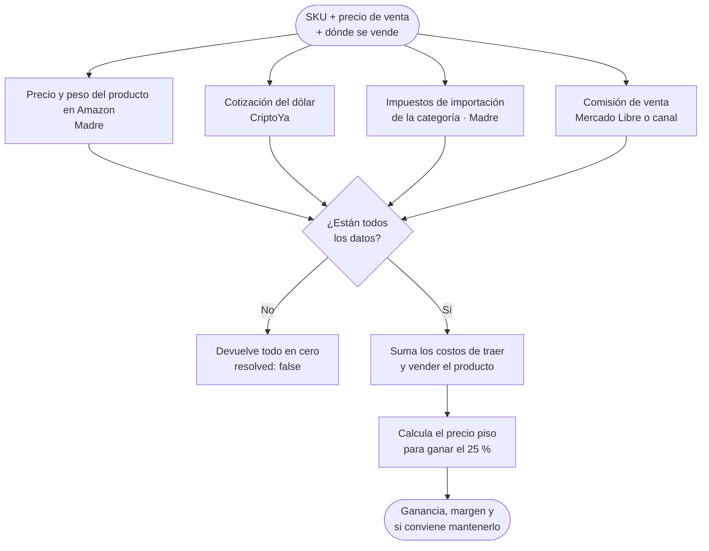

# Price API

Microservicio interno de **Tienda Lo Quiero Acá** que calcula si un producto importado de Amazon deja ganancia al venderlo a un precio dado, en Mercado Libre o en un canal externo (Megatone, Frávega, OnCity).

Recibe el producto (SKU), el precio de venta y dónde se vende. Junta el costo del producto en Amazon, el peso, la cotización del dólar, los impuestos de importación de la categoría y la comisión del canal, y devuelve cuánto cuesta traerlo y venderlo, cuál es el **precio piso** para ganar el 25 % y si conviene mantener la publicación.

No modifica nada: solo calcula. Las decisiones (sumarse a una promoción, pausar, cambiar un precio) las toman los sistemas que lo consultan.

## Qué hace

| | |
|---|---|
| **Rentabilidad en Mercado Libre** | Para una publicación (MLA) a un precio dado, con o sin aporte de Mercado Libre en la promoción. |
| **Rentabilidad en canales externos** | Para un SKU en Megatone, Frávega u OnCity, con la comisión fija de cada canal. |
| **Precio piso** | El precio mínimo de venta que deja un 25 % de ganancia operativa. |
| **Detalle del cálculo** | Cada costo por separado: producto, depósito en USA, courier, impuestos de importación, envío, comisión. |
| **Lotes** | Hasta 50 productos por llamado. |

## Cómo funciona



El detalle de cada paso está en la [guía funcional](docs/funcional.md).

## Quién lo usa

| Sistema | Para qué | Endpoint |
|---|---|---|
| Central de Promociones | Decidir si conviene sumar un producto a una promoción de Mercado Libre. | `/internal/getProfit` · `/internal/getProfit/bulk` |
| Panel de la Central de Promociones | Ver el detalle del cálculo de una promoción. | `/internal/getProfit/details` |
| Panel de administración (Pricing) | Calcular la rentabilidad de una selección de publicaciones. | `/internal/getProfit/details/bulk` |
| Front TLQ (calculadora de precios) | Precios en canales externos. | `/internal/getProfit/channel/details/bulk` |
| Products API | Precio de los productos en Frávega. | `/internal/getProfit/channel` |

## Ambientes

| Ambiente | URL base |
|---|---|
| Producción | `https://api.price.loquieroaca.com` |
| Local | `http://localhost:3000` |

Además de los endpoints, el servicio publica dos herramientas:

| Herramienta | Ruta | Para qué |
|---|---|---|
| Documentación | `/docs` | Esta documentación, navegable y con buscador. |
| Swagger | `/api/docs` | Probar los endpoints desde el navegador. |

## Autenticación

Todos los endpoints, salvo `/health`, usan el mismo header:

| Header | Valor |
|---|---|
| `x-api-key` | La clave del servicio (`API_KEY`). |

Sin el header, o con una clave incorrecta, la respuesta es `401 Missing or invalid x-api-key header`.

## Primer llamado

```bash
curl -s -X POST "https://api.price.loquieroaca.com/internal/getProfit" \
  -H "x-api-key: $PRICE_API_KEY" \
  -H "Content-Type: application/json" \
  -d '{"mla":"MLA2228742950","categoryId":"MLA31040","publicationType":"gold_special","sku":"B0F47N62NN","salePrice":731399}'
```

Antes de usar la respuesta para pausar algo, mirar `status.resolved`: si es `false`, no se pudo calcular y todo viene en cero. Ver [Errores y cálculos incompletos](docs/errores.md).

## Documentación

**Rentabilidad**

| Documento | Qué explica |
|---|---|
| [Guía funcional](docs/funcional.md) | Cómo se calcula: datos que usa, cada costo, el precio piso, cuándo un producto conviene y cuándo hay que pausarlo, con un ejemplo completo. |
| [Errores y cálculos incompletos](docs/errores.md) | Por qué un cálculo puede venir en cero, qué significa cada error y qué hacer. |

**API**

| Documento | Qué explica |
|---|---|
| [Referencia de la API](docs/api.md) | Los ocho endpoints, con parámetros, ejemplos y respuestas. |

**Técnico**

| Documento | Qué explica |
|---|---|
| [Arquitectura y configuración](docs/tecnico.md) | Capas del código, integraciones externas, caché del dólar, variables de entorno, tests y limitaciones conocidas. |
| [Operación](docs/operacion.md) | Deploy, verificación, y qué hacer ante los problemas más frecuentes. |

## Desarrollo local

Requisitos: Node.js 20 o superior.

```bash
npm install
cp .env.example .env    # completar las URLs y claves
npm run start:dev       # http://localhost:3000
```

```bash
npm test                # tests unitarios
npm run lint            # eslint con --fix
npx tsc --noEmit        # chequeo de tipos
```

Para ver la documentación como sitio, sin levantar el resto del servicio:

```bash
npm run docs:preview    # http://localhost:4310/docs
```

## Stack

NestJS 11 · TypeScript · Axios · Jest.
