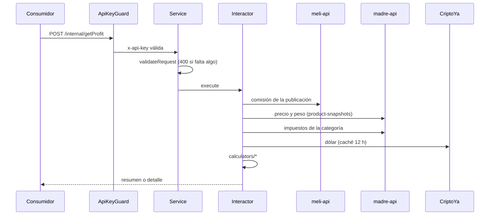

# Arquitectura y configuración

Cómo está armado el código, con qué servicios habla y cómo se configura.

← [Volver al inicio](../README.md)

**Contenido**

1. [Capas del código](#capas-del-código)
2. [El recorrido de un pedido](#el-recorrido-de-un-pedido)
3. [Dónde está cada cosa](#dónde-está-cada-cosa)
4. [Valores fijos del cálculo](#valores-fijos-del-cálculo)
5. [Integraciones](#integraciones)
6. [Errores](#errores)
7. [Variables de entorno](#variables-de-entorno)
8. [Tests](#tests)
9. [Limitaciones conocidas](#limitaciones-conocidas)

---

## Capas del código

NestJS 11 con arquitectura hexagonal. El cálculo vive en `src/core` y se prueba con mocks simples.

```
src/
├── core/                         Lógica de negocio
│   ├── entitis/                  Tipos de lo que devuelven los servicios externos
│   ├── adapters/                 Interfaces de lo que el cálculo necesita de afuera
│   ├── drivers/repositories/     Implementaciones HTTP de esas interfaces
│   ├── errors/                   DependencyError
│   └── interactor/getProfitability/
│       ├── fetchers/             Piden los datos a los repositorios
│       ├── calculators/          Funciones puras: un archivo por bloque del cálculo
│       ├── getProfitability.ts   Orquesta: pide, calcula, arma la respuesta
│       └── getProfitability.config.ts
└── app/                          Todo lo que es NestJS
    ├── controllers/              Endpoints y DTOs de Swagger
    ├── services/                 Validan el pedido y delegan en el interactor
    ├── modules/                  Módulos y providers: acá se cablea todo
    ├── security/                 Guard de x-api-key
    ├── filters/                  Filtro global de errores
    └── drivers/docs/             Sitio de documentación
```

Los interactores reciben sus repositorios por constructor, como interfaces (`GET_DOLAR_REPOSITORY`, `GET_TAXES_REPOSITORY`…), y el módulo `GetProfitability.Module.ts` les asigna la implementación HTTP.

**Regla práctica:** si un cambio es sobre *cómo se calcula* un costo, va en `calculators/`. Si es sobre *cuándo un producto conviene* o *qué pasa si falta un dato*, en `getProfitability.ts`. Si es sobre *cómo se habla* con un servicio externo, en `drivers/repositories/`. Si es sobre validación de entrada, endpoints o configuración, en `app/`.

---

## El recorrido de un pedido



- **De a uno (Mercado Libre):** comisión → producto → impuestos → dólar, en secuencia.
- **Lotes (Mercado Libre):** el dólar, los productos (una sola consulta para todos los SKU) y los impuestos (una por categoría distinta) se piden en paralelo con las comisiones (una por producto).
- **Canales externos:** primero la categoría del SKU en Madre, después producto, impuestos y dólar. La comisión sale de la configuración.

Todos los caminos terminan en `buildDetailedResultFromResolvedData`, que corre los calculadores en este orden:

| Calculador | Produce |
|---|---|
| `calculateDatosBase` | Ingreso del vendedor, peso en kg, peso volumétrico |
| `calculateValorDolar` | `tcTlq`, `tcAmco` |
| `calculateEmo` | Alícuotas de IVA y de derechos y tasas |
| `calculateCostosOperativos` | Producto, depósito, courier (`calculateCostosAmco`), impuestos de importación, envío |
| `calculateCostosCalculados` | Comisión, impuestos sobre la venta, utilidad |
| `calculateResultados` | Costos totales y ganancia operativa |
| `calculatePrecio` | Precio piso y descuento posible |

Si falta el producto, los impuestos o la comisión, devuelve `buildZeroedDetailedResult` (todo en cero y `unresolved: true`).

El resumen (`buildProfitabilityResponse`) se arma a partir del detalle, y ahí se decide `profitable` con `isProfitable` (Mercado Libre) o `isSalesChannelProfitable` (canales).

---

## Dónde está cada cosa

| Necesito cambiar… | Archivo |
|---|---|
| Ganancia objetivo, impuestos sobre la venta, comisiones de canales | `core/interactor/getProfitability/getProfitability.config.ts` |
| Fórmula de un costo | `core/interactor/getProfitability/calculators/*.ts` |
| Regla de `profitable` / `shouldPause` | `core/interactor/getProfitability/getProfitability.ts` (`isProfitable`, `isSalesChannelProfitable`) |
| Qué pasa si falta un dato | `core/interactor/getProfitability/getProfitability.ts` (`shouldReturnZeroedResult`, `buildZeroedDetailedResult`) |
| Validación de los pedidos, canales válidos, tope de 50 | `app/services/getProfitability/get-profitability.service.ts` |
| Endpoints, paginado, ejemplos de Swagger | `app/controllers/GetProfitability/GetProfitability.controller.ts` |
| Forma de las respuestas en Swagger | `app/controllers/GetProfitability/dto/*.ts` |
| Consulta de la comisión | `core/drivers/repositories/meli-api/getCommissionCategory/GetCommissionCategoryRepository.ts` |
| Consulta del dólar y su caché | `core/drivers/repositories/getDolar/GetDolarRepository.ts` |
| Consultas a Madre | `core/drivers/repositories/madre-api/*` |
| Formato de los errores 503 / 500 | `app/filters/all-exceptions.filter.ts` |
| Clave del servicio | `app/security/api-key.guard.ts` |
| Swagger, sitio de documentación, nivel de logs | `main.ts` |
| Sitio de documentación: páginas publicadas y menú | `app/drivers/docs/docs-site.router.ts` |

---

## Valores fijos del cálculo

| Valor | Cuánto | Dónde |
|---|---|---|
| Ganancia operativa objetivo | `targetOperatingProfitPercent: 0.25` | `getProfitability.config.ts` |
| Impuestos sobre la venta | `meliTaxesPercent: 0.02` | `getProfitability.config.ts` |
| Utilidad adicional | `utilityPercent: 0` | `getProfitability.config.ts` |
| Comisiones de canales | `salesChannelCommissions` | `getProfitability.config.ts` |
| Envío promedio | `ENVIO_ML_PROMEDIO_AMOUNT = 11000` | `calculateCostosOperativos.ts` |
| Franquicia de importación | `400 * tcTlq` | `calculateCostosOperativos.ts` |
| Valor en aduana | `precioAmz * 1.01 + 2.5 * weightKg * tcTlq` | `calculateCostosOperativos.ts` |
| Depósito en USA | `20 * tcTlq` | `calculateDepositoUsa.ts` |
| Tarifas del courier | fórmula completa | `calculateCostosAmco.ts` |
| Peso volumétrico | `weightKg * 1.35` | `calculatepesoVolumetrico.ts` |
| Libras a kilos | `0.45359237` | `calculateDatosBase.ts` |
| Recargos del dólar | `officialBuy * 1.02`, `buy * 1.025` | `calculateValorDolar.ts` |
| IVA 11 % → 10,5 % | `normalizeIvaCatAranc` | `calculateEmo.ts` |
| Tope de descuento en canales | `discountPercent > 40` | `getProfitability.ts` |
| Formato de SKU | `/^B0[A-Z0-9]{8}$/` | `getProfitability.ts` |
| Tope de lote | `MAX_BULK_ITEMS = 50` | `get-profitability.service.ts` |
| Vigencia del dólar | `CACHE_TTL_MS = 12 h` | `GetDolarRepository.ts` |

---

## Integraciones

| Servicio | Para qué | Qué se llama |
|---|---|---|
| **meli-api** | Comisión de Mercado Libre | `GET /meli/products/{mla}/commission?price=&category_id=&listing_type_id=` |
| **Madre API** | Precio en Amazon y peso | `POST /api/automeli/product-snapshots/search` |
| **Madre API** | Impuestos de la categoría | `POST /api/internal/taxes/categories/by-mla` |
| **Madre API** | Categoría de un SKU (canales externos) | `POST /api/mercadolibre/products/categories/by-skus` |
| **CriptoYa** | Dólar MEP y oficial | `GET https://criptoya.com/api/dolar` |

### Notas por integración

**meli-api.** Base `MELI_API_BASE_URL` (por defecto `https://api.meli.loquieroaca.com`), clave en `MELI_API_KEY` con el header `MELI_API_KEY_HEADER` (por defecto `x-api-key`); si no hay clave, se llama sin header. Timeout de 10 s. El porcentaje se toma del primer campo presente entre `sale_fee_details.meli_percentage_fee`, `sale_fee_details.percentage_fee`, `percentage` y `percentage_fee`; si no viene ninguno, queda en **0** sin aviso. Cualquier error se convierte en `DependencyError('meli-api')`.

**Madre API.** Base `MADRE_API_BASE_URL`. La búsqueda de productos y la de categorías son públicas; la de impuestos usa `x-internal-api-key: MADRE_INTERNAL_API_KEY`. Timeout de 30 s. Los errores se convierten en `MadreHttpError` con el código de Madre, o `500` si no hubo respuesta. Un `404` se trata como dato faltante (resultado en cero), no como error.

- *Productos:* pide solo `sku`, `totalPrice` y `maxWeight`, con `uniqueBySku: true`. `totalPrice` es el precio en Amazon en dólares; `maxWeight` está en **libras**. Si Madre devuelve más de un registro para un SKU, se usa el primero.
- *Categorías:* de las publicaciones asociadas al SKU, se usa la categoría de la primera (`matches[0]`).
- *Impuestos:* se usan `composicion_conf_automeli_iva` (IVA) y `composicion_conf_automeli_imp2` (derechos y tasas). El resto de los campos no se usa.

**CriptoYa.** Usa `mep.al30.24hs.price` como MEP, `oficial.price` como oficial (y lee `mep.gd30.24hs.price`, que no se usa en el cálculo). Si falta alguno de los tres, la respuesta se considera inválida. Timeout de 5 s.

### Caché del dólar

La cotización se guarda en memoria del proceso por 12 horas. Mientras hay una consulta en curso, los pedidos que llegan esperan esa misma consulta en lugar de lanzar otra. Si CriptoYa falla y hay una cotización guardada, se usa aunque esté vencida (con un `warn` en el log). Si falla y no hay ninguna, `DependencyError('criptoya')`. Un reinicio vacía la caché.

---

## Errores

Un filtro global (`AllExceptionsFilter`) atrapa todo:

| Excepción | Respuesta |
|---|---|
| `HttpException` (400, 401, 404 de Nest) | Se devuelve tal cual. |
| `DependencyError` | `503` · `PRICE_DEP_FAILURE` · `failedDependency` = el servicio. |
| `MadreHttpError` | `503` · `PRICE_DEP_FAILURE` · `failedDependency: "madre-api"`. |
| Cualquier otra | `500` · `PRICE_UNHANDLED_ERROR`. |

En los 503 y 500 escribe en el log una línea con el `correlationId`, el endpoint, la dependencia, el motivo y los primeros 500 caracteres del body. Los campos `statusCode` y `message: "Internal server error"` se mantienen por compatibilidad con los consumidores. El catálogo funcional está en [Errores y cálculos incompletos](errores.md).

**Logs.** Con `NODE_ENV=production` solo se emiten `error` y `warn`: los lotes escribían una línea por producto y eran la mayor parte del volumen. Los avisos de resultado en cero (`Returning zeroed profitability detail…`) y de comisión fallida son `warn`/`error`, así que se ven en producción.

---

## Variables de entorno

| Variable | Obligatoria | Por defecto | Para qué |
|---|---|---|---|
| `PORT` | No | `3000` | Puerto HTTP. |
| `NODE_ENV` | No | — | Con `production`, logs solo de `error` y `warn`. |
| `API_KEY` | **Sí en producción** | `local-dev-api-key` | Clave que deben enviar los consumidores en `x-api-key`. |
| `MADRE_API_BASE_URL` | Sí | — | URL de Madre. Sin ella todo cálculo responde `503 madre-api`. |
| `MADRE_INTERNAL_API_KEY` | Sí | — | Clave interna de Madre, para los impuestos. |
| `MELI_API_BASE_URL` | No | `https://api.meli.loquieroaca.com` | URL de meli-api. |
| `MELI_API_KEY` | No | — | Clave de meli-api. |
| `MELI_API_KEY_HEADER` | No | `x-api-key` | Header en el que se envía `MELI_API_KEY`. |
| `SWAGGER_PATH` | No | `/api/docs` | Ruta de Swagger. |
| `DOCS_SITE_ENABLED` | No | `true` | Publica el sitio de documentación. |
| `DOCS_SITE_PATH` | No | `/docs` | Ruta del sitio de documentación. |
| `DOCS_SITE_USER` / `DOCS_SITE_PASSWORD` | No | — | Con los dos, el sitio pide usuario y clave y publica también la página de operación. Sin ellos queda abierto y esa página no se publica. |

`ConfigModule` lee el `.env` de la carpeta desde la que arranca el proceso. El modelo está en `.env.example`.

> Si `API_KEY` no está definida, el servicio acepta la clave `local-dev-api-key`. En producción tiene que estar siempre definida.

---

## Tests

```bash
npm test                # unitarios (src/**/*.spec.ts)
npm run test:e2e        # e2e (test/), levanta la app completa
```

| Test | Qué cubre |
|---|---|
| `getProfitability.bulk.spec.ts` | Que la falla de la comisión de un producto no tire el lote, y que la falla del dólar sí. |
| `all-exceptions.filter.spec.ts` | Formato de los 503 y 500 y que las `HttpException` pasen intactas. |
| `docs-site.router.spec.ts` | Que el sitio solo sirva los archivos de la lista, y el comportamiento con y sin credenciales. |
| `test/app.e2e-spec.ts` | `/health` público y `/` protegido por clave. |

Los calculadores no tienen tests propios.

---

## Limitaciones conocidas

- **`profitable` en Mercado Libre no evalúa la ganancia.** Solo controla datos completos, peso y formato de SKU. Un producto que pierde plata sale `profitable: true`. Ver [Cuándo conviene y cuándo pausar](funcional.md#cuándo-conviene-y-cuándo-pausar).
- **`economics.cost` es el precio piso**, no un costo, y `profitAmount` es la diferencia contra ese piso, no la ganancia operativa.
- **Un cálculo incompleto sale con `shouldPause: true`.** Quien consume tiene que mirar `resolved` antes.
- **Los lotes de Mercado Libre no validan cada producto.** Un producto sin `sku` o `categoryId` hace fallar el lote con `500`.
- **No hay validación de tipos en la entrada** (no hay `ValidationPipe`): las validaciones son las que hace a mano el service.
- **Comisión ambigua cerca del 1 %.** Un valor mayor a 1 se interpreta como porcentaje (14 → 14 %) y uno menor o igual como fracción (0,14 → 14 %). Una comisión de exactamente 1 % se tomaría como 100 %.
- **Comisión ausente = 0 %.** Si meli-api responde sin ningún campo de porcentaje, el cálculo sigue con comisión cero.
- **Envío fijo de $11.000** para cualquier producto, sin importar tamaño ni destino.
- **El paginado de los lotes no ahorra trabajo:** se calcula el lote completo y después se corta la página.
- **Caché del dólar por proceso:** cada reinicio vuelve a consultar CriptoYa; si en ese momento no responde, los cálculos fallan hasta que responda.
- **`core` importa tipos de `app`** (los DTOs del request y la respuesta), al revés de lo que pide la arquitectura.
- **Si falta la configuración de Madre, el error no lo dice:** se ve como una falta de respuesta (`503 madre-api`, `status 500`).
